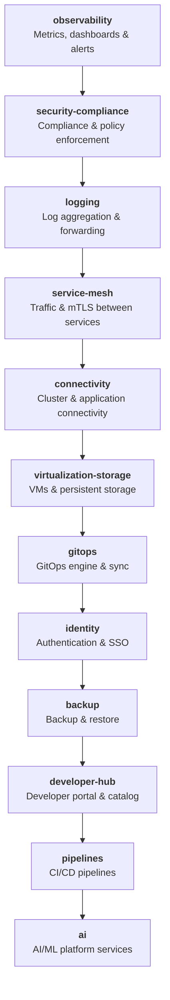
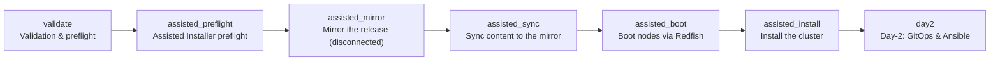

# OpenShift Automation Framework

This repository provides a vendor-neutral OpenShift automation framework. Its canonical Day-0 path installs OpenShift on bare metal in connected, partially disconnected, or fully air-gapped environments. Day-2 content remains separate and must not be invoked by the installation playbook.

The Day-0 installation path uses the Red Hat Assisted Installer API, `oc-mirror` v2, Ansible Vault, and standards-based Redfish. HPE iLO, Dell iDRAC, and other standards-compliant BMCs use the same `bmc_*` contract. Dell-specific `idrac_*` variables remain compatibility aliases only.

For the complete installation procedure, variable catalog, network examples, and disconnected workflows, see [Day-0 bare-metal installation](docs/day0-bare-metal-installation.md).

Day-2 work supports two delivery modes over the same variable contracts:
**Ansible direct mode**, which applies validated resources immediately, and
**GitOps mode**, which renders the same desired state for Argo CD
reconciliation after its minimal control-plane bootstrap. The GitOps workflow
selects operators from a catalog of more than 50 Red Hat, certified, and
requested ecosystem components, resolves dependencies, renders Kustomize and
Argo CD resources, creates an oc-mirror v2 operator image set, and can publish
the result to a configurable Git repository. See
[Day-2 GitOps operator deployment](docs/day2-gitops-operator-deployment.md).

The ordered Day-2 foundation applies the platform components in this order:



The optional containerized GUI interface discovers the same
inventory defaults and operator catalog, creates encrypted profiles, and runs
only approved playbooks with RBAC, confirmation gates, redacted live output,
and persistent history. See the [GUI interface guide](docs/gui-interface.md).

For complete procedures, use the
[executive deployment runbook](docs/deployment-scenarios.md) and the
[playbooks, GUI, and Helm reference](docs/playbooks-reference.md), which
explains what every playbook, role, and GUI action does. It is organized
into three operating paths:

1. **Playbooks** — connected installation, disconnected installation, Day-2
   activities, and GitOps initialization.
2. **GUI interface** — the same four procedures through validated forms and
   allowlisted actions.
3. **Operators** — GitOps deployment and configuration of selected operators
   and their operands.

## Installation and Day-2 options

### Initial installation: Ansible playbooks or the GUI interface

Both options drive the same Day-0 workflow (Redfish discovery, virtual media,
Assisted Installer) over the same inventory and Vault contracts, in connected,
partially disconnected, or fully air-gapped environments and for any
OpenShift version the Assisted Installer and `oc-mirror` v2 support:



- **Option A — Ansible playbooks.** Run the canonical entry points directly
  (`playbooks/day0/discover-bmc.yml`, `playbooks/03-test-virtual-media.yml`,
  `playbooks/day0/prepare-mirror.yml`, `playbooks/day0/install.yml`). See
  [Ansible execution](#ansible-execution) below.
- **Option B — GUI interface.** Deploy one container on the bastion node and
  work through guided forms with RBAC, confirmation gates, and redacted live
  output:

  ```bash
  export INSTALLER_UI_AUTH_TOKENS="$(openssl rand -hex 24)=admin"
  set -a
  . ./.installer-ui.vault
  set +a
  printf 'INSTALLER_UI_AUTH_TOKENS=%s\n' "$INSTALLER_UI_AUTH_TOKENS" > .installer-ui.vault
  chmod 600 .installer-ui.vault
  podman compose config --quiet
  podman compose build --no-cache installer-ui
  podman compose up -d installer-ui
  curl --fail --retry 10 --retry-connrefused --retry-delay 2 \
    http://127.0.0.1:8080/healthz
  ```

  Open http://127.0.0.1:8080 and sign in with the token before the `=`
  (`make gui-build` + `make gui-run` remains as an alternative launcher).

  On Windows, use the PowerShell equivalent instead of `make`:
  `scripts/gui-run.ps1` (requires Podman or Docker Desktop).

#### Filling in the variables (GUI)

You do not edit YAML by hand. The GUI builds its forms from the defaults in
`inventories/sample/group_vars/all/*.yml` and presents them preloaded —
change only what differs in your environment. Required fields are marked,
and conditional fields appear from your choices (the Disconnected group only
shows with `deployment_mode: disconnected`; the offline token only with
`assisted_auth_mode: saas`). On save, the GUI asks for a Vault password,
writes the profile inventory under `/data`, and encrypts every secret; the
**Validate** action then runs the same contracts as the playbooks and lists
errors per field. Saved secrets are never shown again — the GUI only reports
whether they are set. The groups you must use:

- **Cluster** (00-required): `deployment_mode`, `cluster_name`,
  `base_dns_domain`, `openshift_version`, `control_plane_count`,
  `compute_count`, machine/cluster/service networks, API and ingress VIPs.
- **Assisted Installer API** (10-assisted-installer): `assisted_api_url`,
  `assisted_auth_mode` (`saas` or `onprem`).
- **Networking** (20-network): `node_network_config_mode` (static or dhcp),
  DNS servers, interface mode (single or bond).
- **Disconnected** (30-disconnected): `disconnected_environment`,
  `oc_mirror_workflow`, mirror registry — disconnected mode only.
- **BMC / Redfish** (40-bmc): certificate validation, timeouts, boot device,
  plus one card per host: name, role, BMC type (auto, iLO, iDRAC, generic),
  HTTPS endpoint, MAC, installation disk, static or DHCP networking.
- **Runtime** (50-runtime): artifacts directory, ISO delivery mode.
- **Day-2 GitOps** (60-day2-gitops): desired-state repository and branch,
  profiles, and the Day-2 operator selection.
- **Secrets** (Vault): pull secret, SSH public key, Assisted Installer
  offline token, and each host's BMC credentials — stored only encrypted in
  `vault.yml`.

Where each token comes from:

- **GUI access token** — you generate it yourself; it does not come from
  Red Hat or any service. Always export it as
  `export INSTALLER_UI_AUTH_TOKENS="$(openssl rand -hex 24)=admin"` and save
  it in a vault file under the same variable name (`.installer-ui.vault`,
  mode 600) to reuse across sessions. The format is `token=role` with roles
  `viewer` (read-only), `operator`, and `admin`; several comma-separated
  tokens can be declared for different people. The part before the `=` is
  what you type on the GUI login screen.
- **Assisted Installer offline token** (SaaS only) — created in your Red Hat
  account at cloud.redhat.com (the OpenShift API token page) and pasted into
  the Secrets group as `vault_assisted_offline_token`. In `onprem` mode the
  access token of the local Assisted service is used instead
  (`vault_assisted_access_token`).
- **Pull secret** — downloaded from the same Red Hat console
  (`vault_pull_secret`). **BMC credentials** come from each physical server:
  the administrator user and password of its iLO or iDRAC, one entry per
  host card.

### Platform support

| Capability | Linux | macOS | Windows |
| --- | --- | --- | --- |
| GUI container (canonical GUI deployment) | Native with Podman/Docker | Podman Machine or Docker Desktop | Podman or Docker Desktop; start it with `scripts/gui-run.ps1` |
| Ansible playbooks (control node) | Native | Native (via `pip`) | Only under WSL2 — Ansible does not support a native Windows control node |
| Repository validation (`scripts/validate.sh`, `scripts/preflight.sh`) | Native (bash) | Native (bash) | WSL2 or Git Bash |
| GUI binary (`installer-ui`, Go) | Native binary | Native binary | Native binary, but its actions shell out to Ansible and the bash validation script, so the container is the supported Windows path |

The container image is the portable execution path: it is identical on all
three platforms and bundles Ansible, `oc`, `oc-mirror` v2, Kustomize, and
Helm. The GUI binary cross-compiles cleanly for linux/amd64, linux/arm64,
darwin/amd64, darwin/arm64, and windows/amd64.

### Day 2: GitOps or Ansible direct

After installation, choose per component or for the whole baseline:

- **GitOps** — render the desired state, publish it, and bootstrap OpenShift
  GitOps (`make day2-render`, `make day2-deploy`, or
  `playbooks/gitops-foundation.yml`). See [GitOps execution](#gitops-execution).
- **Ansible direct** — apply the same desired state immediately with Ansible
  for controlled administration, break-glass recovery, or clusters not yet
  managed by GitOps (for example `playbooks/day2/oauth.yml` with
  `-e day2_deployment_mode=direct`, or
  `playbooks/install-platform-operator.yml` with
  `-e operator_lifecycle_deployment_mode=direct`).

Direct and GitOps modes must describe equivalent Kubernetes desired state;
only the delivery mechanism differs.

## Architecture

The framework separates:

1. **Day-0 installation** — Redfish discovery, virtual media, Assisted Installer, host matching, and installation evidence.
2. **Platform operators** — catalog-driven installation and operator readiness.
3. **Operands and Day-2 configuration** — identity, PKI, registries, networking, storage, observability, backup, health, and platform services.
4. **GitOps desired state** — Kustomize-first Argo CD/OpenShift GitOps reconciliation.
5. **Validation and reporting** — normalized component results with Markdown, JSON, HTML, and CSV outputs.

Important directories:

```text
framework/                   Component, operand, profile, and result schemas
gitops/                      Argo CD bootstrap and Kustomize desired state
group_vars/                  Global defaults and examples
inventories/                 Environment-specific inventories and overrides
playbooks/day0/              Bare-metal discovery and Assisted Installer
playbooks/day2/              Day-2 cluster and platform configuration
playbooks/audit_vmware_network.yml
roles/                       Reusable Ansible roles
reports/                     Generated validation evidence
workshop/                    Workshop site (Open Demo Days template) and AsciiDoc sources
```

## Requirements

- Python 3.11 or later
- `ansible-core` 2.18 or later
- `oc`, `curl`, `jq`, Git, Kustomize, and Helm
- Access to the target BMCs and the selected Assisted Installer service
- `oc-mirror` v2 and a registry for disconnected installation
- Ansible Vault or an external secret manager

Install dependencies:

```bash
python3 -m pip install -r requirements.txt
ansible-galaxy collection install -r requirements.yml
```

## Inventory model

The sample inventory separates required values, optional API defaults, networking, disconnected mirroring, BMC settings, runtime controls, and encrypted secrets:

```text
inventories/sample/group_vars/
├── all/
│   ├── 00-required.yml
│   ├── 10-assisted-installer.yml
│   ├── 20-network.yml
│   ├── 30-disconnected.yml
│   ├── 40-bmc.yml
│   ├── 50-runtime.yml
│   └── 60-day2-gitops.yml
└── vault.yml.example
```

Environment values override those defaults:

```text
inventories/
├── lab/
├── development/
├── testing/
├── production/
└── examples/
```

Recommended precedence is global defaults, environment group variables, environment host variables, and explicit command-line values. Secrets must be encrypted with Ansible Vault or resolved externally; plaintext passwords, pull secrets, tokens, private keys, and kubeconfigs must not be committed.

## Ansible execution

### 1. Prepare an inventory

```bash
cp -a inventories/sample inventories/lab-cluster
# Use playbooks/day0/create-vault.yml as documented in the Day-0 guide.
```

#### What to edit and fill in

Never run against the sample unedited: fill in your copy. Preflight fails
while any `CHANGE_ME` placeholder remains.

1. **`hosts.yml`** — one block per server under `control_plane` or
   `workers`: `bmc_type` (`ilo`, `idrac`, `generic`, or `auto`),
   `bmc_endpoint` with the real BMC address (`https://<iLO/iDRAC-IP>`),
   `node_role` (`master` or `worker`), the final `node_hostname`, and a
   static `node_ipv4_address` without prefix. Optional:
   `installation_disk_id` (a stable `/dev/disk/by-id/…` path) and
   `mac_interface_map_override` when NIC ordering is ambiguous. Do not edit
   `bmc_username`/`bmc_password`: they resolve from the Vault by inventory
   hostname (see below).
2. **`group_vars/all/00-required.yml`** — `cluster_name` (replace
   `CHANGE_ME_CLUSTER_NAME`), `base_dns_domain`, `openshift_version`,
   `deployment_mode` (`connected` or `disconnected`), node counts matching
   your host list, `machine_networks`, `cluster_networks`,
   `service_networks`, `vip_allocation_mode`, `api_vips`, `ingress_vips`.
3. **`group_vars/all/10-assisted-installer.yml`** — `assisted_auth_mode`:
   `saas` (default public URL) or `onprem` (point `assisted_api_url` at
   your local service).
4. **`group_vars/all/20-network.yml`** — real `node_dns_servers`, `static`
   or `dhcp` node config mode, and bond ports when bonding.
5. **`group_vars/all/30-disconnected.yml`** — only for
   `deployment_mode: disconnected`: `disconnected_environment`,
   `oc_mirror_workflow`, and your `oc_mirror_registry`.
6. **`group_vars/all/50-runtime.yml`** — `iso_http_advertise_address`:
   replace `CHANGE_ME_CONTROL_NODE_IP` with the bastion's reachable IP.
7. **`group_vars/vault.yml`** — copy `vault.yml.example` and fill in
   `vault_pull_secret` (downloaded from the Red Hat console),
   `vault_ssh_public_key`, `vault_assisted_offline_token` (the API token
   from your cloud.redhat.com account; SaaS only — on-prem uses
   `vault_assisted_access_token`), and `vault_bmc_credentials` with one
   entry per inventory hostname holding that server's iLO/iDRAC
   administrator user and password. Then encrypt it:
   `ansible-vault encrypt inventories/lab-cluster/group_vars/vault.yml`.
8. **Vault password** — export `ANSIBLE_VAULT_PASSWORD_FILE` or pass
   `--ask-vault-pass` so the playbooks can read the secrets.

Preflight (`./scripts/preflight.sh`) checks the required tools (python3,
ansible, curl, jq, oc, podman), that no `CHANGE_ME` remains, and that the
Vault is encrypted.

Use generic Redfish host variables:

```yaml
bmc_type: auto          # auto | ilo | idrac | generic
bmc_endpoint: https://10.10.10.11
bmc_username: "{{ vault_bmc_credentials[inventory_hostname].username }}"
bmc_password: "{{ vault_bmc_credentials[inventory_hostname].password }}"
```

### 2. Validate the repository and inventory

```bash
./scripts/validate.sh inventories/lab-cluster/hosts.yml
ansible-inventory -i inventories/lab-cluster/hosts.yml --list >/dev/null
```

### 3. Discover BMCs

```bash
ansible-playbook \
  -i inventories/lab-cluster/hosts.yml \
  --ask-vault-pass \
  playbooks/day0/discover-bmc.yml
```

### 4. Validate virtual media on one host

Always constrain destructive or boot-changing tests to an explicitly selected host:

```bash
ansible-playbook \
  -i inventories/lab-cluster/hosts.yml \
  --ask-vault-pass \
  playbooks/03-test-virtual-media.yml \
  --limit worker-0 \
  -e test_iso_url=https://mirror.example.com/agent.iso
```

### 5. Run Assisted Installer

```bash
ansible-playbook \
  -i inventories/lab-cluster/hosts.yml \
  --ask-vault-pass \
  playbooks/day0/install.yml
```

The same entry point is used for all connectivity models. Set `deployment_mode`, `disconnected_environment`, and `oc_mirror_workflow` in inventory. The playbook stops after installation credentials and evidence are downloaded; it does not perform Day-2 cluster mutations.

The canonical installation and discovery entry points are under `playbooks/day0/`. Retired wrapper paths are intentionally absent and are prohibited by repository validation.

### 6. Install a platform operator

```bash
ansible-playbook playbooks/install-platform-operator.yml \
  -e operator_lifecycle_component=acm \
  -e operator_lifecycle_deployment_mode=direct
```

### 7. Apply Day-2 configuration directly

```bash
ansible-playbook playbooks/day2/oauth.yml \
  -e day2_deployment_mode=direct
```

Direct mode applies validated resources with `kubernetes.core.k8s` and should be used for controlled administration, break-glass recovery, or environments not yet managed by GitOps.

### 8. Install custom API and Ingress certificates

The canonical playbook for replacing the OpenShift API named certificate and the default Ingress wildcard certificate is:

```text
playbooks/day2/install_certs.yml
```

The playbook accepts local PEM certificate and private-key paths through:

- `WILDCARD_CER`
- `WILDCARD_KEY`
- `API_CER`
- `API_KEY`
- `API_DOMAIN`
- `INGRESS_DOMAIN`

It supports three modes:

- `validate` — default; validates files, PEM parsing, remaining lifetime, hostname coverage, and certificate/private-key matching without changing the cluster.
- `render` — writes a protected manifest under `rendered/day2/certificates/` for local review.
- `apply` — creates the TLS Secrets, updates the default IngressController, reconciles the API named certificate, preserves unrelated API named certificates, and waits for operator recovery.

Validate first:

```bash
ansible-playbook playbooks/day2/install_certs.yml \
  -e WILDCARD_CER=/absolute/path/apps-wildcard.cer \
  -e WILDCARD_KEY=/absolute/path/apps-wildcard.key \
  -e API_CER=/absolute/path/api.cer \
  -e API_KEY=/absolute/path/api.key \
  -e API_DOMAIN=api.cluster.example.com \
  -e INGRESS_DOMAIN='*.apps.cluster.example.com'
```

Render for review:

```bash
ansible-playbook playbooks/day2/install_certs.yml \
  -e CERT_INSTALL_MODE=render \
  -e WILDCARD_CER=/absolute/path/apps-wildcard.cer \
  -e WILDCARD_KEY=/absolute/path/apps-wildcard.key \
  -e API_CER=/absolute/path/api.cer \
  -e API_KEY=/absolute/path/api.key \
  -e API_DOMAIN=api.cluster.example.com \
  -e INGRESS_DOMAIN='*.apps.cluster.example.com'
```

Back up the current configuration and apply:

```bash
mkdir -p evidence/certificates
oc get apiserver cluster -o yaml \
  > evidence/certificates/apiserver-before.yaml
oc get ingresscontroller default -n openshift-ingress-operator -o yaml \
  > evidence/certificates/ingresscontroller-before.yaml

ansible-playbook playbooks/day2/install_certs.yml \
  -e CERT_INSTALL_MODE=apply \
  -e WILDCARD_CER=/absolute/path/apps-wildcard.cer \
  -e WILDCARD_KEY=/absolute/path/apps-wildcard.key \
  -e API_CER=/absolute/path/api.cer \
  -e API_KEY=/absolute/path/api.key \
  -e API_DOMAIN=api.cluster.example.com \
  -e INGRESS_DOMAIN='*.apps.cluster.example.com'
```

Certificate changes trigger progressive reconciliation of Ingress router and kube-apiserver operands. Keep the original administrative session open until both ClusterOperators are Available and not Degraded, the API presents the expected certificate, a representative route presents the wildcard certificate, and a new login succeeds.

Rendered manifests contain private keys and must never be committed. Use SOPS, Sealed Secrets, External Secrets, Vault integration, or another approved encrypted-secret mechanism for GitOps delivery.

## GitOps execution

Kustomize is the default composition mechanism. Helm is used only when a chart provides meaningful lifecycle value.

### 1. Configure the Git source

Review the repository URL, target revision, cluster destination, project, and environment overlay under `gitops/bootstrap/` and `gitops/overlays/`.

### 2. Render desired state without cluster changes

```bash
ansible-playbook playbooks/gitops-foundation.yml \
  -e gitops_foundation_mode=render \
  -e gitops_foundation_environment=lab
```

### 3. Bootstrap OpenShift GitOps

```bash
ansible-playbook playbooks/gitops-foundation.yml \
  -e gitops_foundation_mode=gitops \
  -e gitops_foundation_environment=production
```

GitOps mode renders desired-state manifests and bootstraps standardized `AppProject`, `Application`, root application, and `ApplicationSet` resources. Generated files are never committed or pushed automatically unless the explicit Git-write workflow is enabled.

### 4. Validate desired state

```bash
kustomize build gitops/overlays/production >/tmp/production.yaml
kubeconform -strict -ignore-missing-schemas /tmp/production.yaml
```

Direct and GitOps modes must describe equivalent Kubernetes desired state. Direct mode applies that state immediately; GitOps mode publishes it for Argo CD reconciliation.

## Deployment modes

For new Day-2 deployments, use the safe render preview and then the explicit
Git publish/bootstrap workflow:

```bash
make day2-render
make day2-deploy
```

The containerized GUI interface implementation, runtime, security model, and
operating procedure are documented in the [GUI interface guide](docs/gui-interface.md).

Components declare supported modes in `framework/components.yml`:

- `direct`: apply resources with Ansible.
- `render`: generate desired-state manifests without applying them.
- `gitops`: render manifests and reconcile through OpenShift GitOps.

The dependency resolver distinguishes mandatory dependencies, recommendations, conflicts, ordering-only constraints, and required external configuration.

## Validation and reports

Every component should emit the normalized `component_result` contract defined in `framework/component-result.schema.yml`.

Generate reports:

```bash
ansible-playbook playbooks/generate-component-report.yml \
  -e component_results=@reports/input/component-results.json
```

Outputs are written under `reports/output/` as Markdown, JSON, HTML, and CSV.

## VMware network audit

The read-only VMware network audit is located at:

```text
playbooks/audit_vmware_network.yml
```

Run it with encrypted or externally resolved credentials:

```bash
ansible-playbook playbooks/audit_vmware_network.yml \
  --ask-vault-pass \
  -e vcenter_hostname=vcenter.example.com \
  -e vcenter_username=auditor@vsphere.local
```

`vcenter_password` must come from Ansible Vault or an external secret lookup. The playbook does not contain a default password.

## Quality gates

Pull requests run YAML parsing, `yamllint`, `ansible-lint`, Python compilation, Ruff, pytest, inventory validation, Ansible syntax checks, Molecule when scenarios exist, ShellCheck, actionlint, Kustomize, Helm, kubeconform, secret scanning, workshop site checks, and documentation link validation.

Cluster integration tests, destructive tests, and scheduled compatibility tests are separate workflows with explicit credentials and approval boundaries.

## Workshop

The published workshop is the **OpenShift Automation Framework Workshop**:
<https://psehgaft.github.io/ocp-ansible-agent-installer/>

It provides a progressive, hands-on path for automating bare-metal discovery,
OpenShift installation, Day-2 platform configuration, health validation, and
managed-cluster deployment. The site is a single static page
(`workshop/index.html`) built on the
[Open Demo Days workshop template](https://github.com/OpenDemoDays/open-demo-day-template)
— in four languages (English by default, plus Spanish, Portuguese, and
German), with no build step; see
[Deploying the workshop](docs/workshop-deployment.md). The complete AsciiDoc
sources remain under `workshop/documentation/` as reference material.

### Canonical deployment scenarios

1. **Deployment with Playbooks**
   - 1.1 Connected OpenShift
   - 1.2 Disconnected OpenShift
   - 1.3 Day-2 Activities
   - 1.4 GitOps Initialization
2. **Deployment with the GUI Interface**
   - 2.1 Connected OpenShift
   - 2.2 Disconnected OpenShift
   - 2.3 Day-2 Activities
   - 2.4 GitOps Initialization
3. **Operators**
   - 3.1 GitOps Deployment and Configuration

### Curriculum

- **Module 1: Foundations** — workstation, repository, inventory, dependency,
  profile, and credential foundations. Expected result: a validated execution
  environment and inventory that can be used safely by the remaining modules.
- **Module 2: Redfish Validation** — out-of-band management validation for
  mixed-vendor HPE iLO and Dell iDRAC systems. Expected result: every target
  host has verified BMC access, deterministic network identity, and working
  virtual-media capability.
- **Module 3: OpenShift Installation** — discovery ISO, Redfish boot, Assisted
  Installer validation, and installation verification. Expected result: an
  installed and operational OpenShift cluster with installation evidence
  retained for troubleshooting and audit.
- **Module 4: Ordered Day-2 Foundation** — NTP, node labels, identity (LDAP,
  HTPasswd, OAuth), platform operators (ACM, ACS, storage, virtualization,
  MTV, AAP, certificates, PKI, registries, networking, monitoring, logging,
  observability, bare-metal, load-balancer, RHOSO, OADP) through direct or
  GitOps delivery. The custom serving-certificate lesson is `4.4.8.1 Custom
  API and Ingress Certificates` (validation, rendering, application, endpoint
  verification, rollout impact, and rollback). Expected result: a
  policy-driven Day-2 baseline with verifiable readiness.
- **Module 5: Health Check and Day-2 Operations** — platform health checks,
  structured reports and remediation evidence, framework extension, and
  template rendering. Expected result: a repeatable health-check workflow and
  a documented method for adding new automation safely.
- **Module 6: Deploy a Cluster from ACM** — cluster and network templates,
  validation, deployment through direct or GitOps workflows, and managed
  cluster verification. Expected result: a validated ACM-managed cluster
  deployment with reusable templates and deployment evidence.
- **Module 7: Challenge** — an integrated end-to-end scenario combining BMC
  diagnosis, installation, Day-2 foundations, health validation, framework
  extension, and an ACM-based cluster deployment. Expected result: a complete
  evidence package covering the full automation lifecycle.

### Workshop outcomes

By completing the workshop, you will be able to:

- Prepare a repeatable Ansible execution environment and protect sensitive data.
- Discover and validate mixed-vendor HPE iLO and Dell iDRAC systems through Redfish.
- Install and verify OpenShift with the Assisted Installer workflow.
- Execute connected or disconnected installation through playbooks or the GUI interface.
- Configure ordered Day-2 foundations and platform operators through direct or GitOps delivery.
- Render and bootstrap Day-2 GitOps through playbooks or the GUI interface.
- Run health checks, generate evidence, and extend the automation framework safely.
- Generate, validate, and deploy a managed cluster from Red Hat Advanced Cluster Management.
- Complete an integrated challenge that exercises the full automation lifecycle.

## Migration and deprecation

See:

- [Repository compliance audit](docs/repository-compliance-audit.md)
- [Deprecation inventory](docs/deprecated-files.md)
- [Migration from iDRAC](docs/migration-from-idrac.md)
- [Architecture](docs/architecture.md)
- [Troubleshooting](docs/troubleshooting.md)

Do not restore retired compatibility wrappers. Canonical workflow paths and the migration conditions are enforced by `framework/workflows.yml` and CI.

## Security boundary

Never commit plaintext credentials, pull secrets, Assisted Installer tokens, kubeconfigs, private keys, vCenter passwords, or generated secret payloads. Use Ansible Vault, External Secrets, Sealed Secrets, SOPS, or Vault references.
