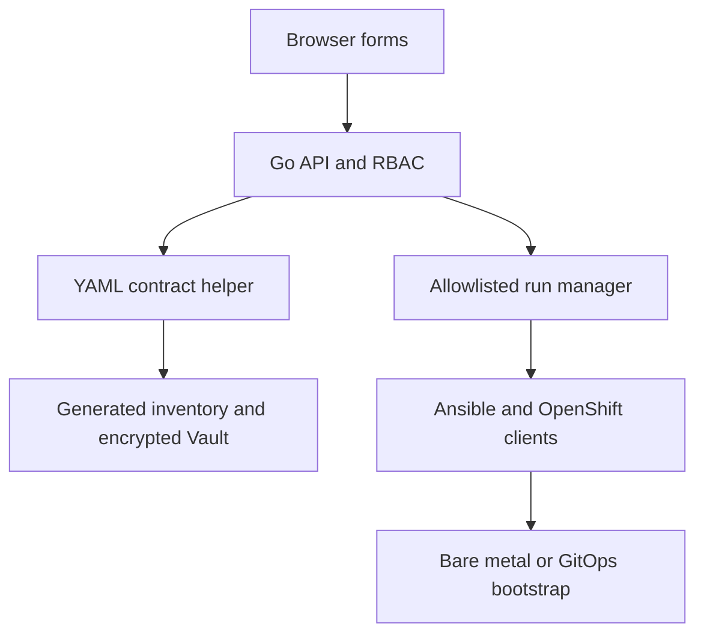

# Containerized GUI Interface

The GUI interface provides a Go web application that turns the repository's
existing YAML contracts into guided forms. It creates isolated installation profiles,
encrypts credentials with Ansible Vault, and runs only an allowlisted set of
Day-0 and Day-2 playbooks. It does not replace Ansible, Assisted Installer, or
OpenShift GitOps.

## Architecture and control boundary



The Go service never accepts an arbitrary command or playbook path. Available
actions come from `framework/gui-actions.yml`. Defaults and operator choices
come from:

- `inventories/sample/group_vars/all/*.yml`;
- `inventories/sample/group_vars/vault.yml.example`;
- `framework/day2-operator-catalog.yml`;
- presentation and conditional-validation hints in
  `framework/gui-variable-metadata.yml`.

The metadata file does not duplicate defaults. A new top-level inventory
variable appears automatically in the UI even when it has no custom metadata.

## Included capabilities

- grouped forms for cluster, Assisted Installer API, networking, disconnected
  installation, BMC/Redfish, runtime, GitOps, and secrets;
- dynamic host cards for iLO, iDRAC, generic Redfish, and automatic detection;
- static or DHCP node networking and explicit installation disk selection;
- profiles and individual selection for all Day-2 operators;
- complete structured values represented as JSON, which is valid YAML;
- conditional and server-side validation;
- encrypted Vault creation without writing credentials into the source tree;
- `viewer`, `operator`, and `admin` bearer-token roles;
- exact confirmation phrases for mirror, boot, install, eject, and GitOps
  deployment actions;
- one active playbook at a time, cancellation, persisted run metadata, audit
  events, and restored history after restart;
- streamed playbook output with submitted secret values and common credential
  assignments redacted;
- downloadable non-sensitive configuration previews and execution reports;
- liveness health check and persistent `/data` volume.

## Build and start

Generate the access token and export it in the canonical form (the random
token has 48 characters; the minimum is 16). Also save it in a vault file
under the same variable name so later sessions can reload it:

```bash
export INSTALLER_UI_AUTH_TOKENS="$(openssl rand -hex 24)=admin"
printf 'INSTALLER_UI_AUTH_TOKENS=%s\n' "$INSTALLER_UI_AUTH_TOKENS" > .installer-ui.vault
chmod 600 .installer-ui.vault
# Later sessions: set -a; . ./.installer-ui.vault; set +a
make gui-build
make gui-run
```

Open `http://127.0.0.1:8080`, select **Access token**, and enter the token —
the part before the `=` in `INSTALLER_UI_AUTH_TOKENS`. The `make gui-run`
target stores profiles and run history in the named volume
`ocp-installer-ui-data`. (The legacy `INSTALLER_UI_ADMIN_TOKEN` variable is
still accepted by `make gui-run` and is mapped to an `=admin` token.)

Podman Compose is also supported:

```bash
export INSTALLER_UI_AUTH_TOKENS="$(openssl rand -hex 24)=admin"
podman compose up --build
```

On Windows, `scripts/gui-run.ps1` is the PowerShell equivalent of
`make gui-build` + `make gui-run` (it uses Podman or Docker Desktop, which
run the same Linux container). On macOS, use Podman Machine or Docker
Desktop. The container is the supported GUI path on every platform; the
Ansible control node itself runs natively on Linux and macOS and under
WSL2 on Windows.

The container fails closed when it listens on a non-loopback address without
`INSTALLER_UI_AUTH_TOKENS`. The variable accepts comma-separated `token=role`
pairs:

```bash
INSTALLER_UI_AUTH_TOKENS="viewer-token-at-least-16=viewer,operator-token-at-least-16=operator,admin-token-at-least-16=admin"
```

Use TLS at the ingress or reverse proxy. Bearer tokens must not traverse an
unencrypted external network.

## Container build troubleshooting

The image pins Kustomize and Helm in `build-tools/go.mod` and locks their
module checksums in `build-tools/go.sum`. The build retrieves those modules
through the configured Go module proxy and verifies them against the committed
checksums. It no longer downloads Kustomize or Helm release archives from
GitHub Releases, which avoids the curl TLS error (exit code 35) seen on some
Mac container-engine networks.

If your environment requires an HTTP(S) proxy or a custom trusted CA, configure
it in the container engine's build environment. After pulling the updated
checkout, rebuild the image:

```bash
podman compose build --no-cache installer-ui
podman compose up -d
```

Use `docker compose` in place of `podman compose` when running Docker. The
Compose Bake/BuildKit warning is informational and is not itself a build
failure.

## Variables: groups, filling rules, and token origins

The GUI never asks you to edit YAML by hand. Its forms are generated from
the defaults in `inventories/sample/group_vars/all/*.yml` and presented
preloaded; change only what differs in your environment. Required fields
are marked, conditional fields appear from your choices (the Disconnected
group only with `deployment_mode: disconnected`, the offline token only
with `assisted_auth_mode: saas`), and list fields such as the networks are
edited as YAML in place. Saving asks for a Vault password, writes the
profile inventory under `/data`, and encrypts every secret; saved secrets
are never displayed again — the GUI only reports whether they are set.

Groups and the variables that matter in each:

- **Cluster** (00-required): `deployment_mode`, `cluster_name`,
  `base_dns_domain`, `openshift_version`, `control_plane_count`,
  `compute_count`, `machine_networks`, `cluster_networks`,
  `service_networks`, `vip_allocation_mode`, `api_vips`, `ingress_vips`.
- **Assisted Installer API** (10-assisted-installer): `assisted_api_url`
  and `assisted_auth_mode` (`saas` or `onprem`).
- **Networking** (20-network): `node_network_config_mode` (static or
  dhcp), `node_dns_servers`, and the install-network mode (single or
  bond, with its bond ports).
- **Disconnected** (30-disconnected): `disconnected_environment`,
  `oc_mirror_workflow`, `oc_mirror_registry` — only in disconnected mode.
- **BMC / Redfish** (40-bmc): `bmc_validate_certs`, timeouts, and
  `bmc_boot_device`, plus one card per host carrying `bmc_type` (auto,
  ilo, idrac, generic), `bmc_endpoint`, `node_role`, `node_hostname`,
  `node_ipv4_address`, the optional `installation_disk_id`, and static or
  DHCP node networking.
- **Runtime** (50-runtime): `artifacts_dir` and the ISO delivery mode
  (`iso_delivery_mode`, `iso_http_advertise_address`).
- **Day-2 GitOps** (60-day2-gitops): the desired-state Git repository and
  branch, bootstrap profiles, and the operator selection.
- **Secrets** (Vault): `vault_pull_secret`, `vault_ssh_public_key`,
  `vault_assisted_offline_token` (or `vault_assisted_access_token`
  on-prem), and `vault_bmc_credentials` keyed by inventory hostname.

Where each token comes from:

- **GUI access token** — self-generated; it does not come from Red Hat or
  any service. Canonical form:
  `export INSTALLER_UI_AUTH_TOKENS="$(openssl rand -hex 24)=admin"`,
  persisted in the `.installer-ui.vault` file under the same variable name
  (see Build and start). Format `token=role`; roles are `viewer`,
  `operator`, and `admin`.
- **Assisted Installer offline token** — created in your Red Hat account
  at cloud.redhat.com (the OpenShift API token page); SaaS mode only. On
  premises, the local Assisted service access token is used instead.
- **Pull secret** — downloaded from the Red Hat console. **BMC
  credentials** — the administrator user and password of each server's
  iLO or iDRAC.

## Container runtime contents

The image builds and tests the Go application, installs the repository's
Python and Ansible requirements and collections, and includes:

- `ansible-playbook` and `ansible-vault`;
- `oc` and `kubectl` for the configured OpenShift 4.18 z-stream;
- `oc-mirror` v2;
- Git and OpenSSH clients;
- Kustomize and Helm;
- Podman for workflows that require container operations;
- the complete repository and the compiled `installer-ui` binary.

`OPENSHIFT_VERSION` is a Containerfile build argument and defaults to
`4.18.41`. Rebuild the image with the z-stream validated for the target
environment.

## Persistent and sensitive data

Generated profiles use this layout:

```text
/data/
├── artifacts/<profile>/
├── inventories/<profile>/
│   ├── hosts.yml
│   ├── .gui-state.json
│   └── group_vars/
│       ├── all/gui-values.yml
│       └── vault.yml
├── runs/<run-id>/
│   ├── run.json
│   └── events.ndjson
├── secrets/<profile>.vault-password
└── audit.ndjson
```

Files containing credentials or execution details use mode `0600`; profile
directories use mode `0700`. By default, the Vault password entered in the UI
is stored under `/data/secrets` so a saved profile remains executable after a
restart. For production, mount a read-only password file and set:

```bash
INSTALLER_UI_VAULT_PASSWORD_FILE=/run/secrets/ansible-vault-password
```

With that setting, the submitted Vault password is ignored and no managed
password file is created.

Never place the persistent data volume in Git. Back it up and protect it using
the same controls as other deployment credentials.

## Roles and actions

| Action | Minimum role | Confirmation |
|---|---:|---:|
| Validate configuration | viewer | None |
| Run preflight | operator | None |
| Discover BMC inventory | operator | None |
| Prepare release mirror | operator | `MIRROR` |
| Boot discovery ISO | admin | `BOOT` |
| Install OpenShift | admin | `INSTALL` |
| Eject virtual media | admin | `EJECT` |
| Render Day-2 GitOps | operator | None |
| Publish and bootstrap GitOps | admin | `GITOPS` |

The Day-2 double-confirmation variables still apply to Git push. The GUI
confirmation authorizes the action but does not silently set
`day2_gitops_git_push_enabled` or `day2_gitops_git_push_confirmed`.

## Network and Podman considerations

The container must reach BMC endpoints, Assisted Installer, DNS, registries,
the desired-state Git repository, and the OpenShift API as required by the
selected workflow. Ensure routing and firewall policy permit those paths.

The `local_http` ISO delivery mode uses Podman. Nested rootless Podman may need
`/dev/fuse` and additional user-namespace configuration. In tightly restricted
environments, use `existing_http` and serve the ISO from an approved external
endpoint, or connect the container client to an approved host Podman service.
Do not grant `--privileged` merely to simplify the UI deployment.

## Development and validation

```bash
make gui-test
python3 scripts/gui_config.py schema --root . | jq '.variables | length'
podman build --target ui-builder -f Containerfile .
```

The GUI interface CI workflow runs formatting, `go vet`, Go race-enabled tests,
Python tests, a binary/API smoke test, and the full container build. Existing
repository validation workflows continue to run unchanged.

## End-to-end procedures

Use the canonical [OpenShift deployment scenarios](deployment-scenarios.md) for
complete, ordered procedures for connected and disconnected installation with
the CLI or GUI, followed by Day-2 GitOps through either interface.


## References

- [Go Modules Reference: go.sum files](https://go.dev/ref/mod#go-sum-files)
- [Kustomize v5.7.1 module definition](https://github.com/kubernetes-sigs/kustomize/blob/kustomize/v5.7.1/kustomize/go.mod)
- [Helm v3.17.3 module definition](https://github.com/helm/helm/blob/v3.17.3/go.mod)
- [OpenShift oc-mirror architecture support](https://docs.redhat.com/en/documentation/openshift_container_platform/4.20/html/disconnected_environments/about-installing-oc-mirror-v2)
