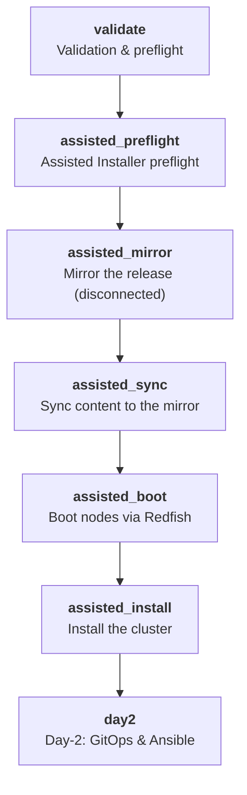

# Playbooks, GUI, and Helm reference

This reference explains, in one place, what every executable part of the
framework does: all 95 playbooks, the 42 reusable roles behind them, the 9
actions exposed by the containerized GUI, and the role Helm plays (and does
not play) in this repository. For end-to-end procedures see the
[executive deployment runbook](deployment-scenarios.md); for the variable
contracts see the [variable reference](variable-reference.md).

## How execution works

- Everything runs from a control node (the bastion) with Ansible against an
  inventory copied from `inventories/sample`. Secrets live only in the
  Ansible Vault file of that inventory.
- Day-0 (installation) and Day-2 (platform configuration) are separate:
  installation playbooks never mutate an installed cluster, and Day-2
  playbooks never install one.
- The GUI never invents behavior: each of its actions runs one of the
  playbooks below through `framework/gui-actions.yml`, with role-based
  authorization and typed confirmations for destructive steps.

## Day-0 and shared playbooks

These are the installation entry points plus the shared utilities every
path uses. Run them in the order listed.

| Playbook | What it does | Key roles |
|---|---|---|

| `playbooks/configure-bastion.yml` | Configure OpenShift automation bastion workstation | `bastion_workstation` |
| `playbooks/day0/create-vault.yml` | Create the encrypted Day-0 credentials vault | `vault_bootstrap` |
| `playbooks/00-preflight.yml` | Validate control-node, cluster, and BMC inputs | `preflight` |
| `playbooks/day0/discover-bmc.yml` | Discover vendor-neutral Redfish inventory | `preflight`, `bmc_discovery`, `bmc_report` |
| `playbooks/03-test-virtual-media.yml` | Test Redfish virtual media on one or more selected hosts | `preflight`, `bmc_discovery`, `bmc_virtual_media` |
| `playbooks/day0/prepare-mirror.yml` | Prepare OpenShift release content for a disconnected installation | — |
| `playbooks/02-boot-discovery-iso.yml` | Create Assisted Installer discovery ISO and boot bare-metal hosts | `preflight`, `bmc_discovery`, `assisted_auth`, `assisted_cluster` |
| `playbooks/day0/install.yml` | Install OpenShift with Assisted Installer and vendor-neutral Redfish | `preflight`, `bmc_discovery`, `bmc_report`, `oc_mirror` |
| `playbooks/90-eject-media.yml` | Eject discovery ISO from all BMCs | `preflight`, `bmc_discovery`, `bmc_eject_media` |
| `playbooks/framework-runtime.yml` | Build and validate the OpenShift framework runtime plan | `framework_runtime` |
| `playbooks/gitops-foundation.yml` | Configure GitOps foundation | `platform_validation`, `gitops_foundation` |
| `playbooks/install-platform-operator.yml` | Install or render one platform operator from the catalog | `operator_catalog_validation`, `operator_lifecycle` |
| `playbooks/install-platform-operators.yml` | Install and configure optional OpenShift platform operators | `openshift_virtualization_operator`, `odf_operator`, `cluster_baremetal_operator` |
| `playbooks/generate-component-report.yml` | Generate consolidated component validation reports | `component_report` |
| `playbooks/audit_vmware_network.yml` | Audit VMware vSphere network architecture read-only | — |
| `playbooks/openstack-prepare.yml` | "Create ports needed for OpenShift control plane nodes" | `openstack_port_create` |

## Day-2 playbooks

Day-2 playbooks configure an installed cluster. They are grouped below by
function; the ordered foundation in Module 4 of the workshop applies them
in the sequence observability, security-compliance, logging, service-mesh,
connectivity, virtualization-storage, gitops, identity, backup,
developer-hub, pipelines, ai. Each playbook is idempotent and safe to
re-run; most accept `-e component_name=<key>` or a profile variable to
limit scope.

### Platform operator stacks (`platform-*`)

| Playbook | What it does | Key roles |
|---|---|---|
| `playbooks/day2/platform-baremetal.yml` | Configure the OpenShift Bare Metal Operator | — |
| `playbooks/day2/platform-cert-manager.yml` | Install cert-manager Operator for Red Hat OpenShift | — |
| `playbooks/day2/platform-cluster-observability.yml` | Install and configure Cluster Observability Operator | — |
| `playbooks/day2/platform-csi-drivers.yml` | Install and configure vendor CSI drivers | — |
| `playbooks/day2/platform-load-balancer.yml` | Install and configure MetalLB load balancing | — |
| `playbooks/day2/platform-local-storage.yml` | Install and configure Local Storage Operator | — |
| `playbooks/day2/platform-logging.yml` | Install and configure OpenShift Logging and Loki | — |
| `playbooks/day2/platform-lvm-storage.yml` | Install and configure LVM Storage Operator | — |
| `playbooks/day2/platform-monitoring.yml` | Configure OpenShift monitoring resources | — |
| `playbooks/day2/platform-network-observability.yml` | Install and configure Network Observability Operator | — |
| `playbooks/day2/platform-networking.yml` | Install and configure platform networking operators | — |
| `playbooks/day2/platform-observability-stack.yml` | Configure platform monitoring | — |
| `playbooks/day2/platform-oadp.yml` | Install and configure OpenShift API for Data Protection | — |
| `playbooks/day2/platform-operator-bundle.yml` | Install and configure a platform operator bundle | — |
| `playbooks/day2/platform-operators.yml` | Install ACM | — |
| `playbooks/day2/platform-pki.yml` | Configure platform PKI resources | — |
| `playbooks/day2/platform-quay.yml` | Install and configure Red Hat Quay | — |
| `playbooks/day2/platform-rhoso.yml` | Install and configure Red Hat OpenStack Services on OpenShift | — |

### Identity and access

| Playbook | What it does | Key roles |
|---|---|---|
| `playbooks/day2/ldap.yml` | Configure LDAP or Active Directory identity provider | `day2_identity` |
| `playbooks/day2/ldap-group-sync.yml` | Configure LDAP group synchronization | `ldap_group_sync` |
| `playbooks/day2/htpasswd.yml` | Configure HTPasswd identity provider | `day2_identity` |
| `playbooks/day2/oauth.yml` | Reconcile OpenShift OAuth and validate authentication operator | `day2_identity` |
| `playbooks/day2/identity-manager.yml` | Configure the LDAP identity provider | — |
| `playbooks/day2/cluster-admin-rbac.yml` | Reconcile explicit cluster-admin RBAC assignments | — |

### Certificates and PKI

| Playbook | What it does | Key roles |
|---|---|---|
| `playbooks/day2/cert-manager.yml` | Configure cert-manager issuers and certificates | `day2_pki` |
| `playbooks/day2/certificates.yml` | Configure OpenShift API and Ingress certificates | `day2_pki` |
| `playbooks/day2/certificate-audit.yml` | Run certificate audit | `day2_operational_workflow` |
| `playbooks/day2/install_certs.yml` | Validate and install custom API and Ingress certificates | — |
| `playbooks/day2/trusted-ca.yml` | Configure additional OpenShift trust bundles | `day2_pki` |

### Networking

| Playbook | What it does | Key roles |
|---|---|---|
| `playbooks/day2/networking.yml` | Configure cluster networking | `day2_cluster_operations` |
| `playbooks/day2/nmstate.yml` | Configure NMState policies | `day2_cluster_operations` |
| `playbooks/day2/metallb.yml` | Configure MetalLB pools and advertisements | `day2_cluster_operations` |
| `playbooks/day2/ingress.yml` | Configure cluster ingress | `day2_cluster_operations` |
| `playbooks/day2/sriov.yml` | Configure SR-IOV | `day2_cluster_operations` |
| `playbooks/day2/ptp.yml` | Configure PTP | `day2_cluster_operations` |
| `playbooks/day2/submariner.yml` | Configure ACM Submariner add-on and placement resources | — |

### Storage and data protection

| Playbook | What it does | Key roles |
|---|---|---|
| `playbooks/day2/storage.yml` | Install and configure OpenShift Data Foundation | — |
| `playbooks/day2/storageclasses.yml` | Configure StorageClasses | `day2_cluster_operations` |
| `playbooks/day2/volume-snapshots.yml` | Configure volume snapshot classes | `day2_cluster_operations` |
| `playbooks/day2/odf-day2.yml` | Configure ODF Day-2 resources | `day2_cluster_operations` |
| `playbooks/day2/backup-oadp.yml` | Configure backup and OADP | `day2_operational_workflow` |
| `playbooks/day2/oadp.yml` | Deploy and configure OpenShift API for Data Protection | `day2_oadp` |
| `playbooks/day2/etcd-backup.yml` | Create an OpenShift etcd backup on one control-plane node | — |

### Observability and logging

| Playbook | What it does | Key roles |
|---|---|---|
| `playbooks/day2/monitoring.yml` | Configure cluster monitoring | `day2_operational_workflow` |
| `playbooks/day2/user-workload-monitoring.yml` | Configure user workload monitoring | `day2_operational_workflow` |
| `playbooks/day2/alertmanager.yml` | Configure Alertmanager | `day2_operational_workflow` |
| `playbooks/day2/logging.yml` | Configure logging and forwarding | `day2_operational_workflow` |
| `playbooks/day2/loki.yml` | Configure Loki | `day2_operational_workflow` |
| `playbooks/day2/multicluster-observability.yml` | Configure ACM multicluster observability aggregation | — |

### Security and compliance

| Playbook | What it does | Key roles |
|---|---|---|
| `playbooks/day2/acs.yml` | Install and configure Red Hat Advanced Cluster Security | — |
| `playbooks/day2/acs-policies.yml` | Configure Red Hat Advanced Cluster Security policy resources | `day2_operational_workflow` |
| `playbooks/day2/compliance.yml` | Install and configure the Compliance Operator | — |
| `playbooks/day2/file-integrity.yml` | Install and configure the File Integrity Operator | — |

### ACM and multicluster

| Playbook | What it does | Key roles |
|---|---|---|
| `playbooks/day2/acm.yml` | Install and configure Red Hat Advanced Cluster Management | — |
| `playbooks/day2/acm-hub.yml` | Configure ACM Hub | `day2_operational_workflow` |
| `playbooks/day2/acm-bmh-static-networking.yml` | Render or apply ACM BareMetalHost static networking | `acm_bmh_static_networking` |

### GitOps delivery

| Playbook | What it does | Key roles |
|---|---|---|
| `playbooks/day2/bootstrap-gitops.yml` | Render, publish, and initialize OpenShift Day-2 GitOps | `day2_gitops_render`, `day2_gitops_bootstrap` |
| `playbooks/day2/render-gitops.yml` | Render and optionally publish OpenShift Day-2 desired state | `day2_gitops_render` |
| `playbooks/day2/gitops-application-lifecycle.yml` | Install OpenShift GitOps and configure application lifecycle resources | — |

### Registries and mirroring

| Playbook | What it does | Key roles |
|---|---|---|
| `playbooks/day2/external-registries.yml` | Configure external registry credentials and trust | `day2_registry` |
| `playbooks/day2/mirror-sets.yml` | Configure ImageDigestMirrorSet and ImageTagMirrorSet resources | `day2_registry` |
| `playbooks/day2/quay.yml` | Configure Red Hat Quay operands | `day2_registry` |
| `playbooks/day2/registry-proxy.yml` | Configure cluster proxy and disconnected registry settings | `day2_registry` |

### Virtualization and migration

| Playbook | What it does | Key roles |
|---|---|---|
| `playbooks/day2/virtualization.yml` | Install and configure Red Hat OpenShift Virtualization | — |
| `playbooks/day2/virtualization-day2.yml` | Configure OpenShift Virtualization Day-2 resources | `day2_operational_workflow` |
| `playbooks/day2/mtv.yml` | Install and configure Migration Toolkit for Virtualization | — |

### Platform services

| Playbook | What it does | Key roles |
|---|---|---|
| `playbooks/day2/aap.yml` | Install and configure Ansible Automation Platform | — |
| `playbooks/day2/rhoso-day2.yml` | Configure RHOSO Day-2 resources | `day2_operational_workflow` |

### Node and cluster configuration

| Playbook | What it does | Key roles |
|---|---|---|
| `playbooks/day2/chrony.yml` | Configure Chrony and NTP | `day2_cluster_operations` |
| `playbooks/day2/ntp.yml` | Configure OpenShift NTP with MachineConfig | `day2_ntp` |
| `playbooks/day2/node-configuration.yml` | Configure node-level resources | `day2_cluster_operations` |
| `playbooks/day2/node-labels.yml` | Apply validated OpenShift node labels | `day2_node_labels` |
| `playbooks/day2/machineconfig.yml` | Manage MachineConfig resources | `day2_cluster_operations` |

### Health, reporting, and maintenance

| Playbook | What it does | Key roles |
|---|---|---|
| `playbooks/day2/cluster-health.yml` | Run comprehensive OpenShift cluster health checks | — |
| `playbooks/day2/health-checks.yml` | Run consolidated cluster health checks | `day2_operational_workflow` |
| `playbooks/day2/etcd-health.yml` | Run etcd health checks | `day2_operational_workflow` |
| `playbooks/day2/must-gather.yml` | Collect OpenShift must-gather diagnostics | — |
| `playbooks/day2/reports.yml` | Render or apply report-related resources | `day2_operational_workflow`, `consolidated_report` |
| `playbooks/day2/upgrade-prechecks.yml` | Run upgrade prechecks | `day2_operational_workflow` |

## Roles

Playbooks are thin entry points; the work lives in 42 roles under `roles/`.

| Role | What it does | Used by (examples) |
|---|---|---|
| `acm_bmh_static_networking` | Static network configuration for BareMetalHosts provisioned through ACM. | `acm-bmh-static-networking.yml` |
| `assisted_auth` | Authenticates to the Assisted Installer (SaaS offline token or on-prem access token). | `02-boot-discovery-iso.yml` |
| `assisted_cluster` | Creates and tracks the Assisted Installer cluster object and its install config. | `02-boot-discovery-iso.yml` |
| `assisted_hosts` | Registers discovered bare-metal hosts with the Assisted Installer cluster. | — |
| `assisted_install` | Starts the installation and monitors it to completion, collecting evidence. | — |
| `bastion_workstation` | Prepares the control node (packages, CLIs, directories) for automation runs. | `configure-bastion.yml` |
| `bmc_discovery` | Reads Redfish inventory from every BMC and resolves stable installation disks. | `02-boot-discovery-iso.yml`, `03-test-virtual-media.yml`, `90-eject-media.yml` |
| `bmc_eject_media` | Ejects virtual media from all configured BMCs. | `90-eject-media.yml` |
| `bmc_report` | Writes per-host BMC evidence reports used by validation and audits. | `discover-bmc.yml`, `install.yml` |
| `bmc_virtual_media` | Attaches the discovery ISO through Redfish virtual media and sets boot order. | `03-test-virtual-media.yml` |
| `cert_manager_operator` | Installs and configures the cert-manager operator. | — |
| `cluster_baremetal_operator` | Configures the cluster bare-metal operator and BareMetalHost resources. | `install-platform-operators.yml` |
| `component_report` | Emits the per-component result document for one Day-2 component. | `generate-component-report.yml` |
| `component_validation` | Validates a component selection against the catalog contracts. | — |
| `consolidated_report` | Merges component and validation reports into a single evidence file. | `reports.yml` |
| `day2_cluster_operations` | Shared cluster-level Day-2 operations (API access, waits, evidence). | `chrony.yml`, `ingress.yml`, `machineconfig.yml` |
| `day2_gitops_bootstrap` | Bootstraps OpenShift GitOps (Argo CD) and the root application structure. | `bootstrap-gitops.yml` |
| `day2_gitops_render` | Renders Day-2 desired state (Kustomize) without touching the cluster. | `bootstrap-gitops.yml`, `render-gitops.yml` |
| `day2_identity` | Configures identity providers (LDAP, HTPasswd, OAuth) and group bindings. | `htpasswd.yml`, `ldap.yml`, `oauth.yml` |
| `day2_node_labels` | Applies and verifies node labels and taints from the inventory contract. | `node-labels.yml` |
| `day2_ntp` | Configures NTP/chrony for control-plane and worker nodes. | `ntp.yml` |
| `day2_oadp` | Configures OADP backup schedules, locations, and restores. | `oadp.yml` |
| `day2_operational_workflow` | Runs ordered Day-2 operational workflows end to end. | `acm-hub.yml`, `acs-policies.yml`, `alertmanager.yml` |
| `day2_pki` | Issues and distributes platform certificates and CA bundles. | `cert-manager.yml`, `certificates.yml`, `trusted-ca.yml` |
| `day2_registry` | Configures external registries, mirror sets, and registry proxies. | `external-registries.yml`, `mirror-sets.yml`, `quay.yml` |
| `framework_runtime` | Shared runtime bootstrap used by orchestrator playbooks. | `framework-runtime.yml` |
| `gitops_foundation` | Creates GitOps projects, applications, and ApplicationSets for the foundation. | `gitops-foundation.yml` |
| `iso_publish` | Publishes the discovery ISO over HTTP for BMCs that pull media by URL. | — |
| `ldap_group_sync` | Synchronizes LDAP groups into OpenShift groups. | `ldap-group-sync.yml` |
| `metallb_operator` | Installs and configures MetalLB and its address pools. | — |
| `nmstate_operator` | Installs the NMState operator and applies node network policies. | — |
| `oc_mirror` | Runs oc-mirror v2 planning, mirroring, and sync for disconnected environments. | `install.yml` |
| `odf_operator` | Installs and configures OpenShift Data Foundation storage. | `install-platform-operators.yml` |
| `openshift_virtualization_operator` | Installs and configures OpenShift Virtualization (KubeVirt). | `install-platform-operators.yml` |
| `openstack_port_create` | Creates OpenStack ports used by ACM/BMH provisioning flows. | `openstack-prepare.yml` |
| `operator_catalog_validation` | Validates operator catalog selections, channels, and dependencies. | `install-platform-operator.yml` |
| `operator_lifecycle` | Drives OLM install, approval, and upgrade of platform operators. | `install-platform-operator.yml` |
| `platform_validation` | Platform readiness validation shared by Day-2 stacks. | `gitops-foundation.yml` |
| `post_install` | Collects post-installation credentials, evidence, and verification output. | — |
| `preflight` | Validates control-node tooling, inventory contracts, and BMC inputs before any change. | `00-preflight.yml`, `02-boot-discovery-iso.yml`, `03-test-virtual-media.yml` |
| `report` | Generic run reporting used by audit and evidence playbooks. | — |
| `vault_bootstrap` | Creates the Ansible Vault file with the required secret keys. | `create-vault.yml` |

## GUI actions

The GUI (`installer-ui`, Go) exposes exactly the nine actions declared in
`framework/gui-actions.yml`. It stores each configuration as a profile,
encrypts secrets with Ansible Vault, and shows run output and reports; it
never accepts an arbitrary command or playbook path.

| Action | What it does | Min. role | Confirmation | Runs |
|---|---|---|---|---|
| `validate` | Run repository and inventory validation without changing infrastructure. | viewer | — | `scripts/validate.sh` |
| `preflight` | Validate prerequisites and Assisted Installer inputs. | operator | — | `playbooks/00-preflight.yml` |
| `discover` | Read Redfish inventory and resolve stable installation disks. | operator | — | `playbooks/day0/discover-bmc.yml` |
| `mirror` | Render or execute the configured oc-mirror workflow. | operator | `MIRROR` | `playbooks/day0/prepare-mirror.yml` |
| `boot` | Attach virtual media and boot all selected bare-metal hosts. | admin | `BOOT` | `playbooks/02-boot-discovery-iso.yml` |
| `install` | Start and monitor the Assisted Installer bare-metal installation. | admin | `INSTALL` | `playbooks/day0/install.yml` |
| `eject` | Eject installation media from the configured BMCs. | admin | `EJECT` | `playbooks/90-eject-media.yml` |
| `day2-render` | Render desired state locally without touching Git or the cluster. | operator | — | `playbooks/day2/render-gitops.yml` |
| `day2-deploy` | Push approved desired state and initialize OpenShift GitOps. | admin | `GITOPS` | `playbooks/day2/bootstrap-gitops.yml` |

## Helm: what it does here (and what it does not)

This repository ships **no Helm charts of its own** — there is no
`Chart.yaml` in the framework, the GitOps tree, or the playbooks, and no
role templates a chart. Composition is Kustomize-first: desired state
lives under `gitops/` (bootstrap, applications, operators, overlays) and is
rendered by the Day-2 GitOps roles.

Helm appears only at the edges, by design:

- The `kubernetes.core` collection (a declared dependency) provides the
  `helm` and `helm_repository` modules, available to any component whose
  upstream delivery is a chart; the framework rule — see the README's
  GitOps section — is that Helm is used only when a chart provides
  meaningful lifecycle value over Kustomize.
- The `oc_mirror` role carries an `oc_mirror_helm` variable (empty by
  default) reserved for passing chart-related content through the
  disconnected mirroring set when a selected component needs it.
- Operator lifecycle itself is OLM-driven (`operator_lifecycle` role), not
  Helm-driven: catalog components install through subscriptions and
  channels recorded in `framework/day2-operator-catalog.yml`.

If a future component must ship as a chart, it belongs in the GitOps tree
as a rendered source next to its Kustomize base, with its values captured
in the same inventory contracts — never as a standalone install path.

## Framework contracts and GitOps layout

| Path | What it holds |
|---|---|
| `framework/gui-actions.yml` | The GUI allowlist: the nine actions above, their roles and confirmations. |
| `framework/day2-operator-catalog.yml` | The Day-2 operator catalog (50+ components): channels, dependencies, profiles. |
| `framework/components.yml` / `operands.yml` | Component and operand definitions consumed by validation and rendering. |
| `framework/input-contracts.yml` / `schema.yml` | Inventory input contracts and the schema every profile must satisfy. |
| `framework/gui-variable-metadata.yml` | Presentation and conditional-validation hints for GUI forms. |
| `framework/workflows.yml` / `day2-exercises.yml` | Named end-to-end workflows and the workshop exercise definitions. |
| `framework/profiles/` | Reusable selection profiles (minimal, enterprise, observability, and others). |
| `gitops/bootstrap/` | Argo CD bootstrap: instance, projects, and the root application. |
| `gitops/applications/` | Application definitions synced by the root application. |
| `gitops/operators/` | Operator desired state (bases) rendered from the catalog. |
| `gitops/day2/` | Day-2 platform desired state (base). |
| `gitops/overlays/` / `gitops/clusters/` | Per-environment and per-cluster overlays and assignments. |
